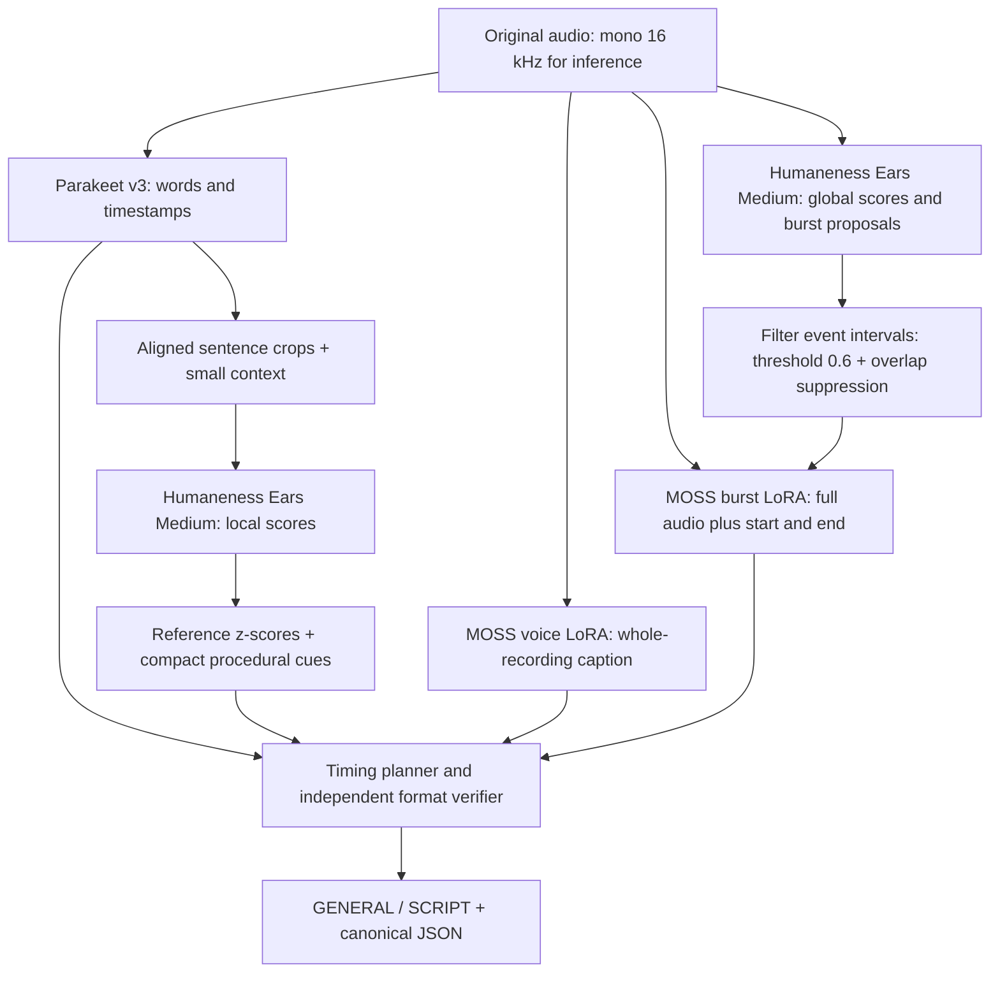

# Humanness Voice Annotator

**[Listen to the 50-example demo →](https://projects.laion.ai/Humanness-Voice-Annotator/)** · [Format guide](https://projects.laion.ai/Humanness-Voice-Annotator/format.html) · [Models and training](https://projects.laion.ai/Humanness-Voice-Annotator/models.html) · [Evaluation](https://projects.laion.ai/Humanness-Voice-Annotator/evaluation.html) · **[Tuning data: captions + MOSS v2 tokens](https://projects.laion.ai/Humanness-Voice-Annotator/training.html)**

Turn audio into a description of the voice and a timed performance script. Humanness Voice Annotator combines **two MOSS captioning adapters, Humaneness Ears Medium, Parakeet v3 and the procedural voice-captioning rules**. Its default output is one documented **`GENERAL / SCRIPT`** format, backed by a JSON sidecar with absolute timestamps and original predictions.

This release connects existing models; it does not train a new neural model. The audio remains the source of evidence. Descriptions, emotion tags and event locations are machine predictions and can be wrong. We publish the predictions, errors, format checks and an audio-based automated review together so you can judge the results yourself.

## What the output looks like

This short example is **illustrative**, not an evaluated recording:

```text
GENERAL: One close-miked speaker speaks quietly and hesitantly, becoming warmer toward the end. A short breath and a light laugh are audible; the background is quiet.
SCRIPT:
(quiet, hesitant; 1.20 seconds duration) I… wasn't sure.
[0.30 seconds pause]
("A short, unvoiced inhalation through the mouth.", 0.40 seconds)
(warmer, relieved; 2.30 seconds duration) ("A soft, breathy laugh.", 0.50 seconds) But I'm glad you came.
```

The elapsed budget is **4.20 seconds**. The laugh is inside the last speech segment, so its 0.50 s is already included in that segment's 2.30 s budget. A standalone burst advances time; an inline burst does not advance it again.

| Part | Meaning | Source |
|---|---|---|
| `GENERAL:` | Full-recording description of audible voice, delivery and environment | MOSS voice-captioner |
| `(cue; N seconds duration)` | Local delivery/emotion cue and elapsed speech-segment budget | Humaneness Ears scores + procedural selection + ASR alignment |
| `("description", N seconds)` | Free-form description of a selected nonverbal vocal event | MOSS burst-captioner, given full audio and **both** event endpoints |
| `[N seconds pause]` | Gap in the inferred speech/event timeline | Word/event endpoints |
| Spoken text | Recognized words, kept once and in order | Parakeet v3 |
| JSON sidecar | Exact starts/ends, overlaps, scores, raw captions, model revisions and provenance | All stages |

Pauses are alignment gaps, not proof of acoustic silence. Their budgets can include background sound or missed events. Speech segments can be shorter than grammatical sentences because pauses split the script. All segments retain their source-sentence index. The round-bracket speech-duration syntax is this project's versioned format; it is an extension of the procedural formatter, whose original output used square-bracket speech durations. See the [complete format contract](https://projects.laion.ai/Humanness-Voice-Annotator/format.html).

## The pipeline



| Component | Responsibility | Release |
|---|---|---|
| Humaneness Ears **Medium** | 40 emotion scores, 57 VoiceNet dimensions, quality scores, embeddings, frame/event predictions and event types | [Model and methods](https://huggingface.co/laion/humaneness-ears-base-medium) |
| Parakeet TDT 0.6B v3 | ASR and word timestamps; supports 25 European languages | [NVIDIA model](https://huggingface.co/nvidia/parakeet-tdt-0.6b-v3) |
| MOSS voice-captioner | Full-recording voice/performance caption | [Weights, inference and training](https://huggingface.co/laion/moss-voice-captioner) |
| MOSS vocal-burst-captioner | Prose about a **specified** interval in the full recording | [Weights, inference and training](https://huggingface.co/laion/moss-vocal-burst-captioner) |
| Procedural voice captions | Reference normalization, cue vocabulary, selection and timing plan | [GitHub](https://github.com/LAION-AI/procedural-voice-captions) |

**Humaneness Ears is encoder-only: it does not transcribe audio.** The Medium variant uses the Whisper Small encoder. ASR is supplied separately by Parakeet. MOSS describes selected events; it does not discover their timestamps. One MOSS base is loaded per worker, and the two LoRA adapters are switched for their respective tasks.

## Run it

Python **3.11+** and FFmpeg are needed. Composition from saved predictions uses only Python's standard library:

```bash
git clone https://github.com/LAION-AI/Humanness-Voice-Annotator.git
cd Humanness-Voice-Annotator
python -m pip install -e .

humanness-annotate from-saved --acoustic examples/acoustic.json \
  --moss examples/moss.json --output outputs/example.json
humanness-annotate verify outputs/example.json
```

This reproduces the first real demo annotation. Download its audio from the listening page; `examples/annotation.json` records its SHA-256. The paired stage sidecars are included for an API-free format check.

The independent formatter contract tests pass. A full fresh-inference smoke test on **three English recordings and one German recording** also passed, running one recording per GH200 GPU with four CPU threads, separate acoustic/MOSS environments and locally staged models. Each run completed all model stages and the final format proof. The 201–208 s per recording include cold model loading and multiple event-caption generations; these are smoke-test times, not a bulk throughput benchmark. [Verification record](docs/data/full-inference-verification.json).

### Fresh model inference

The acoustic stack needs Transformers **5.14.1**, while the released MOSS code needs **4.57.1**. Use two environments to keep these versions separate. Install the appropriate PyTorch build for your accelerator; the supplied requirements record the tested versions.

```bash
python -m venv .venv-acoustic
python -m venv .venv-moss
.venv-acoustic/bin/pip install -r requirements-acoustic.txt -e .
.venv-moss/bin/pip install -r requirements-moss.txt -e .

# Run this once on a machine with internet access. About 22 GB of model data.
.venv-acoustic/bin/python scripts/download_models.py --output models

# No API key is required for annotation. CPU is supported with --device cpu.
HF_HUB_OFFLINE=1 TRANSFORMERS_OFFLINE=1 humanness-annotate annotate clip.mp3 \
  --language en --output outputs/clip.json \
  --acoustic-python .venv-acoustic/bin/python \
  --moss-python .venv-moss/bin/python --device cuda:0 --threads 4 \
  --procedural-dir models/procedural \
  --humaneness-dir models/humaneness_ears --parakeet-dir models/parakeet \
  --voice-dir models/moss_voice --burst-dir models/moss_burst
```

The MOSS voice bundle contains its base and adapter; the download script fetches only the adapter from the burst release, avoiding a second base copy. For offline clusters, download everything on a connected machine before running GPU inference. The runtime also supports automatic downloads when local directory options are omitted and internet access is available.

Each stage writes an atomic sidecar. Successful stages are reused after an interruption, keyed by audio hash, pinned model versions and settings. Local model overrides must contain the matching pinned artifacts; their directory names are recorded in the private cache identity, but their contents are not rehashed. Replace the cache when changing local weights in place. The final public annotation retains original audio SHA-256, all raw captions and scores, selected intervals and the independent format proof.

The current fresh path runs one audio at a time per worker. For a corpus, distribute files across GPU workers and reuse the released model APIs for persistent model loading; the CLI is a reproducible reference, not a throughput-optimized bulk service. MOSS generation dominates latency. See [runtime details](https://projects.laion.ai/Humanness-Voice-Annotator/pipeline.html).

## Default settings and interpretation

| Setting | Default | Meaning |
|---|---:|---|
| Event threshold | 0.60 | Threshold on event-onset proposals; a practical starting point, not a calibrated correctness probability |
| Minimum event length | 0.08 s | Discard very short proposals |
| Overlap suppression | >0.50 of the shorter interval | Remove strongly overlapping proposals; smaller overlaps remain |
| Extra event cap | None | The neural proposal generator still has a capacity of 32 per 30 s window |
| Local VoiceNet cues | At most 2 | Compact cue selection |
| Local emotion cues | At most 1; z ≥0.50 | Keep prominent reference-relative emotions |
| Pleasantness wording | Predicted AudioBox Content Enjoyment | VoiceNet aesthetics remains available in raw outputs |
| Explicit pause threshold | 0.20 s | Short gaps are absorbed into neighboring budgets |
| MOSS decoding | Greedy; temperature 0 | 512 global / 256 event tokens; retry at 1,024 if truncated |

The speech normalizer uses **80,265** predicted reference clips: **41,771 S10 + 38,494 multilingual Emilia**, with arithmetic mean and population standard deviation (`ddof=0`). A z-score is `(raw − mean) / std`. It measures deviation from this reference, **not** an emotion probability. Reference languages are DE/EN/FR/JA/KO/ZH; this does not extend Parakeet's ASR language support. Existing raw teacher annotations are kept separate.

MOSS can still make demographic or psychological claims: its GENERAL text is preserved verbatim. The procedural cue selector omits its own demographic and genuineness wording, but that does not sanitize the separate MOSS caption. Emotion tags, tiny speech segments and overlapping burst proposals deserve listening-based review.

## Humaneness Voice tuning data

**All 38,427 synthetic German/English acting recordings (314.13 hours)** now have the default GENERAL/SCRIPT caption and **MOSS Audio Tokenizer v2** audio targets. The additive release is available in **151 WebDataset TARs, 6.33 GB**, under `tuning/` in the original dataset. Original MP3s, previous caption variants, raw scores/embeddings and exact generation-voice metadata are preserved.

**[Download the tuning release](https://huggingface.co/datasets/laion/german-english-voice-acting-challenges/tree/2f914a5081f6c0d6eb348b509ea50cf1d56aa7e3/tuning)** · [Loading and export guide](TRAINING_DATA.md) · [Explanatory page](https://projects.laion.ai/Humanness-Voice-Annotator/training.html) · [Complete statistics](docs/data/training-summary.json) · [Real training example](examples/tuning/en-00245.json)

| Partition | Clips | Hours | Split unit |
|---|---:|---:|---|
| Train | 36,755 | 300.58 | Challenge scenario |
| Validation | 794 | 6.50 | Challenge scenario |
| Test | 878 | 7.05 | Challenge scenario, including the 50 listening scenarios |

English/German counterparts stay together; voices occur across splits. These partitions prepare later TTS tuning and do not establish independent evaluation of the component caption/score models. The native targets are little-endian int16 **[T,12]**, code range 0–1023, with **80 ms per frame**. The model's `Tokens` budget is **T**. Each clip is explicitly right-padded before encoding, with its true sample count recorded for trimming. The corpus contains **14,157,137 frames**, **312,968 selected vocal-event intervals** and **2,152,571 recognized words**.

The 128-clip codec pilot and native shifted-label packing checks passed. All source IDs/audio hashes/voice/language/subset/duration and scenario partitions were audited. Every caption passed the independent format verifier; this establishes mechanical consistency, not perceptual correctness. See the [preflight](docs/data/training-preflight.json), [export lock](docs/data/training-export-lock.json) and [compute report](docs/data/training-compute-report.json). The full export took **15 min 18 s on 16 GH200 GPUs: 4.08 allocated GPU-hours**, or **4.38 GPU-hours including both pilots**. Timings reuse completed caption predictions; they are not fresh MOSS caption-inference benchmarks. This is a data-preparation release; no new Humaneness Voice training result is claimed.

## Audio-based evaluation of this default format

The final annotations for **50 reused synthetic acting recordings** (45 English, 5 German) were reviewed against their original audio using **Gemini 3.8 Flash**. The reviewer received the emitted GENERAL/SCRIPT, local cues and exact timestamps, without intended TTS scripts or target emotions. The configuration was frozen before these new ratings; we did not optimize it using this report.

| Metric (0–5; higher is better) | Mean | 95% clip bootstrap interval |
|---|---:|---:|
| **Weighted composite** | **3.263** | **3.192–3.332** |
| Whole-recording caption fidelity | 3.82 | 3.70–3.92 |
| Whole-recording emotion fit | 3.74 | 3.60–3.86 |
| Local speech emotion fit | 2.78 | 2.62–2.92 |
| Whole-recording talking-style fit | 3.86 | 3.76–3.94 |
| Local speech delivery fit | 3.10 | 3.02–3.20 |
| Burst-description fit | 3.02 | 2.86–3.16 |
| Burst-timing fit | 2.52 | 2.36–2.68 |
| Event precision **rating** | 2.88 | 2.74–3.00 |
| Event coverage **rating** | 3.46 | 3.32–3.60 |
| Transcript fidelity† | 4.30 | 4.14–4.46 |
| Speech-timing fit† | 3.42 | 3.28–3.56 |
| Readability† | 3.86 | 3.76–3.94 |

† Diagnostics outside the composite. Event precision/coverage are ordinal reviewer ratings, **not measured precision/recall percentages**. The whole-recording acoustic/style descriptions are stronger than local emotion tags and event timing. Reviewer notes identify misplaced fine-grained emotions and redundant or overlapping proposals. The listening demo shows these errors rather than editing them away.

All **50** format proofs pass, covering **2,703 recognized words, 662 timed speech segments and 360 selected burst intervals**. The 662 segments derive from 443 source sentences; split pieces reuse their source-sentence scores. Passing the mechanical proof means that words/events are retained and elapsed budgets agree, not that the predictions match the audio.

This is a **single automated reviewer**, a small English-heavy synthetic sample and a reused listening set, without human adjudication or inter-rater agreement. Confidence intervals reflect clip sampling only. These new rubric scores cannot be numerically compared with the older MOSS/procedural composite, whose criteria and weights differ. Model validation losses and the independent Humaneness Ears benchmarks answer different questions.

The review cost **$0.437 at published list prices**, based on returned token usage; it is not an invoice. [Rubric](evaluation/rubric.json), [review code](evaluation/review.py), [aggregation code](evaluation/summarize.py), [all 50 reviews](docs/data/reviews.jsonl), [summary](docs/data/evaluation-summary.json) and [canonical annotations](docs/data/annotations.jsonl.gz) are included. The [evaluation page](https://projects.laion.ai/Humanness-Voice-Annotator/evaluation.html) explains weights, uncertainty and reproduction.

## Models, training and upstream context

Both MOSS adapters fine-tune the language backbone of [MOSS-Audio-8B-Instruct](https://huggingface.co/OpenMOSS-Team/MOSS-Audio-8B-Instruct). Each has **87,293,952 trainable LoRA parameters**, rank 32 / alpha 64 / dropout 0.05, two epochs, peak LR 1e-4, AdamW, 5% warmup and cosine decay. The audio encoder and original base weights are frozen. The voice adapter uses 58,380 training examples; the burst adapter uses 80,773. Audio-hash-disjoint train/validation/test splits keep a recording's events together. Supervision is machine-generated caption text. This 50-recording TTS demo is not the adapter-training corpus.

The Humaneness Ears model jointly predicts emotion, voice properties, quality and embeddings, and locates/classifies vocal events. Its full training methods and independent score/benchmark evaluations are in its [release](https://huggingface.co/laion/humaneness-ears-base-medium) and [benchmark report](https://laion-whisper-base-small-emotion-voice-burst.static.hf.space/benchmark.html). This repository does not reinterpret automatic emotion predictions as human ground truth.

For details and original taxonomies, follow [EmoNet / emotion annotations](https://github.com/LAION-AI/emotion-annotations), [VoiceNet](https://github.com/LAION-AI/voicenet), [procedural voice captions](https://github.com/LAION-AI/procedural-voice-captions), and each released model card. [The models page](https://projects.laion.ai/Humanness-Voice-Annotator/models.html) includes the executed MOSS training recipe, split sizes and pinned revisions.

## Explore and contribute

Listen to the [new default-format demo](https://projects.laion.ai/Humanness-Voice-Annotator/), compare the [earlier MOSS/procedural listening grid](https://laion-moss-voice-acting-captions.static.hf.space/format-comparison.html), or inspect the [German-English Voice Acting Challenges dataset](https://huggingface.co/datasets/laion/german-english-voice-acting-challenges). The examples retain their voice names, language, source subset and audio hashes.

Useful contributions include listening-based corrections, human evaluation with documented agreement, better event merging, restrained local emotion wording and additional languages with a suitable timestamping ASR backend. Please include a reproducible example, the pinned model versions and a description of the audible error. Preserve the raw prediction alongside corrections.

## License and attribution

**Our orchestration code, documentation and new annotations are CC BY 4.0, attributed to LAION.** See [LICENSE](LICENSE) and [THIRD_PARTY.md](THIRD_PARTY.md). The attributed procedural timing planner is included unchanged at a pinned revision. Upstream MOSS base code/weights retain Apache 2.0; NVIDIA, PyTorch, Transformers, PEFT and other upstream components retain their own terms. This repository does not replace their licenses.

Please cite the exact release/revision when using the pipeline. `humanness_voice_annotator/assets/sources.json` records model revisions; `procedural-source-lock.json` verifies every downloaded procedural source file by SHA-256.


## Voice aliases for the acting-data releases

The [voice-acting training dataset](https://huggingface.co/datasets/laion/german-english-voice-acting-challenges) uses **55 distinct synthetic speaker identities**: 30 standard voices, 24 separate add-on voices, and one additional French-accent character voice. Nine other French-accent voices reuse their standard identity. The standard aliases are unchanged; the add-on aliases have been migrated to neutral, unique names without collisions.

The collections are organized as `standard_voices/en_de/`, `standard_voices/multilingual/`, `standard_voices/emotion_masking_physical/`, `character_voices/french_accent/`, and `add_on_voices/multilingual/`. The new English collection contains 240,000 generated recordings and is being annotated with this pipeline; [live release status](https://huggingface.co/datasets/laion/german-english-voice-acting-challenges/blob/main/metadata/release-status.json) distinguishes generated, annotated, tokenized and uploaded counts. A completed generation is not a completed annotation release.

Every training recording gets its actual ASR, MOSS whole-recording caption, full-audio interval captions, Ears raw/reference-normalized scores and predicted 128D timbre / 250D identity vectors, plus MOSS Audio Tokenizer v2 targets. Historical complete annotations and token arrays are reused without changing their numeric predictions or audio bytes. Earlier archives are retained until complete replacement verification. Generation targets are separate from observed annotations.

The reference-audio manifest selects a different recording of the exact same synthetic speaker, preferring a different dominant **reference-normalized predicted emotion**, a different scenario and the same split. It records the reference audio hash, TAR member and matching MOSS tokens. An unavailable emotion contrast or cross-split fallback is flagged rather than silently treated as an independent reference. The dataset loader can reject cross-split references for held-out evaluation.

The following descriptions paraphrase the frozen generation-time catalogs. They characterize voice presentation rather than real human demographics; unknown pitch/age is not guessed. The actual delivery may vary substantially with the acting challenge. Synthetic origin and source identities remain documented in a separate dataset provenance manifest, while ordinary training fields and paths use aliases. [Machine-readable registry](docs/data/voice-aliases.json).

| Alias | Group | Voice presentation | Register | Catalog age | Description |
|---|---|---|---|---|---|
| Aurora | standard_30 | female | high | not specified | Sunny, optimistic presence with a forward-moving delivery. |
| Killian | standard_30 | male | low | not specified | Cheerful, energetic and approachable, with a substantial vocal body. |
| Ezra | standard_30 | male | low | not specified | Grounded, consistent delivery suited to factual explanation. |
| Liora | standard_30 | female | medium | not specified | Decisive and assured, with a direct presentation. |
| Jasper | standard_30 | male | low | not specified | Passionate, animated delivery with considerable energy. |
| Seraphina | standard_30 | female | high | not specified | Youthful-sounding, lively presence with an energetic delivery. |
| Kael | standard_30 | male | low | not specified | Sober and resolute, with a practical, matter-of-fact delivery. |
| Esme | standard_30 | female | medium | not specified | Airy, light delivery with an unhurried conversational feel. |
| Genevieve | standard_30 | female | medium | not specified | Informal and at ease, with a relaxed conversational manner. |
| Freya | standard_30 | female | medium | not specified | Enthusiastic and positive, with an animated promotional presence. |
| Gideon | standard_30 | male | low | not specified | Quiet and intimate, with an airy, softly produced tone. |
| Jensen | standard_30 | male | low | not specified | Cleanly enunciated, with precise and distinct articulation. |
| Soren | standard_30 | male | low | not specified | Unforced, informal delivery with an easy conversational pace. |
| Declan | standard_30 | male | low | not specified | Refined and flowing, with a composed professional finish. |
| Isolde | standard_30 | female | medium | not specified | Rounded, gentle delivery with a polished professional character. |
| Jocelyn | standard_30 | female | medium | not specified | Precisely articulated, intelligible delivery with a clear instructional feel. |
| Darius | standard_30 | male | low | not specified | Low, textured delivery with a rugged and weighty dramatic presence. |
| Maddox | standard_30 | male | medium | not specified | Measured, explanatory delivery suited to longer narration. |
| Persephone | standard_30 | female | high | not specified | Buoyant and energetic, with an optimistic, outgoing presence. |
| Elara | standard_30 | female | high | not specified | Delicate, restful delivery with a reassuring, soothing quality. |
| Elias | standard_30 | male | low | not specified | Resolute and commanding, with a clear sense of authority. |
| Silas | standard_30 | male | low | not specified | Level and dependable, with an even, balanced delivery. |
| Kaia | standard_30 | female | medium | not specified | Mature-sounding, assured delivery with a formal professional presence. |
| Sloane | standard_30 | neutral | medium | not specified | Assertive and self-possessed, with a direct forward presentation. |
| Caspian | standard_30 | male | low | not specified | Welcoming and personable, with an informal, warm conversational tone. |
| Thorne | standard_30 | male | low | not specified | Relaxed and informal, with an easy, conversational delivery. |
| Celeste | standard_30 | female | medium | not specified | Softly reassuring, with a mild, composed and soothing delivery. |
| Rowan | standard_30 | male | low | not specified | Expressive and lively, with an engaging spoken presentation. |
| Ryder | standard_30 | male | medium | not specified | Assured and explanatory, with an even, knowledgeable presence. |
| Ursula | standard_30 | female | medium | not specified | Reassuring and welcoming, with an inviting, warm delivery. |
| Adrian | add_on_24 | male | unspecified | middle aged | Dominant, resolute delivery with a firm presence. |
| Alina | add_on_24 | female | unspecified | middle aged | Precise, engaging instructional delivery with a professional finish. |
| Bianca | add_on_24 | female | unspecified | middle aged | Luminous, welcoming delivery with a polished professional manner. |
| Bastian | add_on_24 | male | unspecified | old | Seasoned-sounding and considered, with balanced, distinct articulation. |
| Bennett | add_on_24 | male | low | middle aged | Low, full-bodied resonance with a soothing, reassuring presence. |
| Caius | add_on_24 | male | unspecified | middle aged | Textured, husky character delivery with a mischievous edge. |
| Calvin | add_on_24 | male | low | young | Low, self-assured delivery with an animated, energetic character. |
| Cedric | add_on_24 | male | unspecified | middle aged | Personable and unpretentious, with a relaxed conversational presence. |
| Dorian | add_on_24 | male | unspecified | middle aged | Consistent, composed delivery with a formal broadcast character. |
| Edmund | add_on_24 | male | low | middle aged | Low, dark-toned dramatic delivery with a serious character. |
| Emmett | add_on_24 | male | unspecified | middle aged | Flowing and composed, with a dependable conversational presence. |
| Felix | add_on_24 | male | low | old | Low, gravelly texture balanced by a welcoming narrative warmth. |
| Gareth | add_on_24 | male | unspecified | middle aged | Enveloping, engaging narrative delivery with a mature-sounding presence. |
| Hugo | add_on_24 | male | unspecified | young | Rough-edged, forceful character delivery with youthful-sounding energy. |
| Iris | add_on_24 | female | unspecified | young | Lighthearted and radiant, with a welcoming, playful character. |
| Leonie | add_on_24 | female | unspecified | young | Animated, individualistic delivery with a lightly cheeky attitude. |
| Lucian | add_on_24 | male | unspecified | young | Outgoing, self-assured delivery with a lively presentation style. |
| Lydia | add_on_24 | female | unspecified | middle aged | Soft, plush vocal texture with a confident dramatic presence. |
| Marielle | add_on_24 | female | unspecified | middle aged | Well-informed, professional delivery with a positive, animated manner. |
| Remy | add_on_24 | neutral | unspecified | middle aged | Unhurried and composed, with an understated explanatory delivery. |
| Ronan | add_on_24 | male | unspecified | middle aged | Relaxed and informal, with a full, resonant vocal body. |
| Sabine | add_on_24 | female | unspecified | young | Assured and reassuring delivery with a polished, mature-sounding presence. |
| Tobias | add_on_24 | male | low | middle aged | Low, welcoming narrative delivery with a professional finish. |
| Wesley | add_on_24 | male | unspecified | young | Easygoing, positive delivery with an unhurried conversational manner. |
| Gaston | character_extra | male | low / warm (character direction) | not specified | Warm, playful and gallant character; outwardly capable, emotionally receptive and lightly comic. Register and manner are performance directions, not acoustic measurements. |
